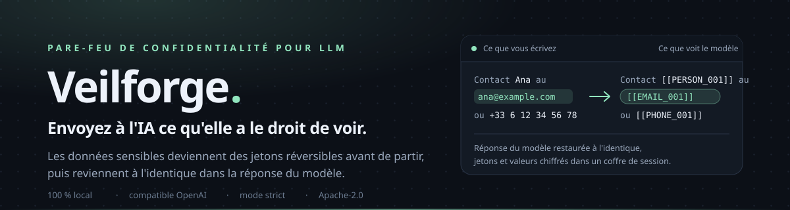
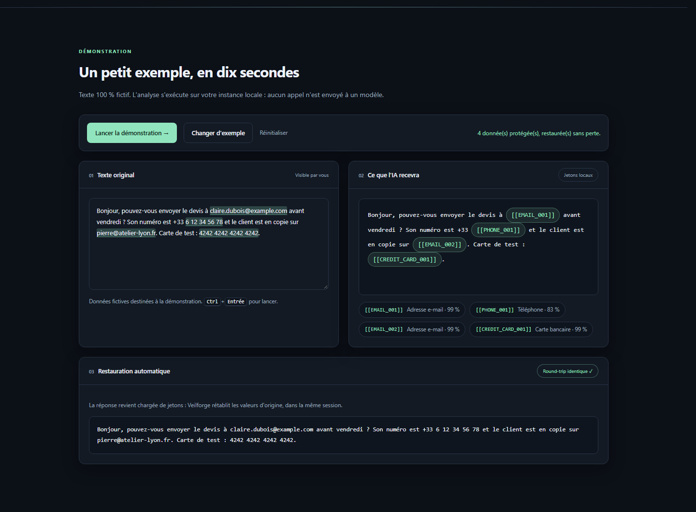
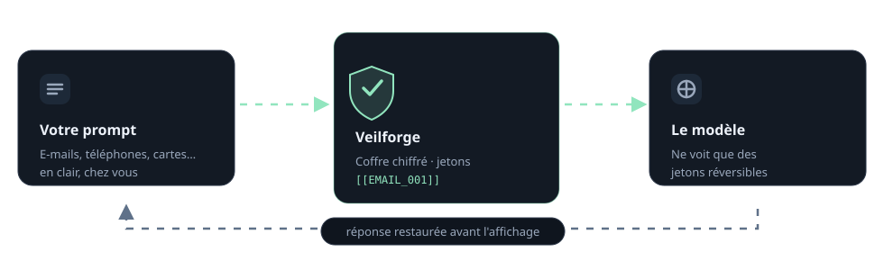

# Veilforge

<picture>
  <source media="(max-width: 600px)" srcset="docs/assets/banner-narrow.svg">
  
</picture>

[](LICENSE)
[](requirements.txt)
[](#verification)
[](#security-model)

Veilforge is an independent implementation inspired by the privacy-gateway problem space; it
contains no code, models or assets from PII Guard.

## At a glance

| | |
|---|---|
| **What** | A privacy firewall in front of any OpenAI-compatible endpoint: detect → replace with session-scoped tokens → forward → restore in the answer |
| **Detection** | Rules only (regex + context + Luhn), runs in-process, no model call, no API cost |
| **Data path** | Everything runs on your machine; the upstream only ever sees `[[EMAIL_001]]`-style tokens |
| **Pages** | `/` presentation page with a live example · `/docs` documentation · `/swagger` OpenAPI UI |
| **License** | [Apache-2.0](LICENSE) |

## What it does

- **What it does.** Change one base URL (or call `/api/v1/mask` yourself) and the names, addresses,
  IDs, credentials and card numbers it finds become reversible placeholders before the request
  leaves. The real values come back in the response, in streams included, and the
  placeholder-to-value mapping never leaves the vault.
- **How it works.** Every value gets a token that is stable inside its session
  (`[[EMAIL_001]]` stays `[[EMAIL_001]]` for the whole conversation), overlapping detections are
  resolved by confidence, and unknown tokens are passed through untouched instead of being mangled.
- **Where your data goes.** In default mode the text is processed only on your machine. With no
  upstream configured the gateway answers a clearly labelled development echo (`mock: true`) and
  never pretends to be a model. Anything fail-closed mode cannot handle is refused rather than
  forwarded unprotected: this is pseudonymization, not anonymization, and not a compliance
  guarantee.

## Quickstart

```bash
# Windows
python -m venv .venv
.venv\Scripts\activate
pip install -r requirements.txt
copy .env.example .env
uvicorn veilforge.main:app --reload --port 8787
```

```bash
# macOS / Linux
python -m venv .venv && . .venv/bin/activate
pip install -r requirements.txt
cp .env.example .env
uvicorn veilforge.main:app --reload --port 8787
```

Or with Docker: `docker compose up --build` (port 8787, data in the `veilforge-data` volume).

Then open **http://localhost:8787**:

- `/` — the presentation page. It ends with a live example that masks a fictional text, shows the
  tokens and restores the original values in the same session; the example runs automatically when
  the page loads.
- `/docs` — the documentation (getting started, example, gateway, API reference, tokens &
  sessions, detection, configuration, security, architecture, tests, FAQ).
- `/swagger` — the interactive OpenAPI UI (`/redoc` and `/openapi.json` too).

The API key defaults to `local-dev-key`; set `VEILFORGE_API_KEY` before exposing the service.
Rate limit: 120 requests per minute per IP.

## The live example



<p align="center"><sub>Runs on your instance: the analysis never calls a model. Hover a pill in
panel 02 for the value, confidence, source and fingerprint.</sub></p>

## Use it from code

### Round trip

Mask, then unmask with the session Veilforge keeps:

```bash
curl -sS http://localhost:8787/api/v1/mask \
  -H 'Content-Type: application/json' \
  -H 'Authorization: Bearer local-dev-key' \
  -d '{"text": "Client : Ana Fournier, ana@example.com, +33 6 12 34 56 78."}'
# {"masked_text":"Client : [[PERSON_001]], [[EMAIL_001]], +33 [[PHONE_001]].",
#  "session_id":"vf_...","entities":[
#    {"type":"PERSON","placeholder":"[[PERSON_001]]","value":"Ana Fournier","confidence":0.69,...},
#    {"type":"EMAIL","placeholder":"[[EMAIL_001]]","value":"ana@example.com","confidence":0.99,...},
#    {"type":"PHONE","placeholder":"[[PHONE_001]]","value":"6 12 34 56 78","confidence":0.83,...}]}

curl -sS http://localhost:8787/api/v1/unmask \
  -H 'Content-Type: application/json' \
  -H 'Authorization: Bearer local-dev-key' \
  -d '{"text": "Done: I emailed [[PERSON_001]] at [[EMAIL_001]].", "session_id": "vf_..."}'
# {"text":"Done: I emailed Ana Fournier at ana@example.com.","unresolved":[]}
```

The session id and the token numbers differ on every run: each new session gets its own.

### Gateway (OpenAI client)

Point an existing client at Veilforge; only the base URL changes:

```python
# pip install openai
from openai import OpenAI

client = OpenAI(base_url="http://localhost:8787/v1", api_key="local-dev-key")
stream = client.chat.completions.create(
    model="gpt-4o-mini",
    stream=True,
    messages=[{"role": "user", "content": "Email Ana at ana@example.com"}],
])
for chunk in stream:
    print(chunk.choices[0].delta.content or "", end="")
```

Without an upstream (`VEILFORGE_UPSTREAM_URL` unset) the gateway returns a development echo of the
masked messages, flagged `"mock": true`, so you can wire a client end to end before you have a
provider. With an upstream set, only the masked request crosses the boundary and the response —
including SSE chunks — is restored token by token on the way back.

Other endpoints: `POST /api/v1/detect`, `/analyze`, `/sessions`, `GET /api/v1/sessions`,
`/analytics`, `/health`. Full reference in [`/docs`](http://localhost:8787/docs) and
[`/swagger`](http://localhost:8787/swagger).

## What the detection covers

| Kind | Confidence | Example |
|---|---:|---|
| `EMAIL` | 0.99 | `ana@example.com` |
| `CREDIT_CARD` | 0.99 | `4242 4242 4242 4242` (Luhn-checked) |
| `PASSWORD` | 0.99 | `mot de passe : S3cur3-Pass`, `password: ...` |
| `SECRET` | 0.95–0.99 | `sk-...`, `gho_...`, `AKIA...`, `eyJhbGciOi...` JWT, private-key blocks, `clé api: ...` |
| `IBAN` | 0.96 | `FR76 3000 6000 0112 3456 7890 189` |
| `IP_ADDRESS` | 0.94 | `192.0.2.14` |
| `BANK_ACCOUNT` | 0.93 | `compte bancaire n° 1234567890` |
| `NATIONAL_ID` | 0.91 | `passeport AB1234567` |
| `ADDRESS` | 0.90 | `12 rue des Lilas, 75011 Paris` |
| `DATE_OF_BIRTH` | 0.88 | `né le 12/03/1984`, `born on ...` |
| `PHONE` | 0.83 | `+33 6 12 34 56 78` |
| `PERSON` | 0.69 | `Client : Ana Fournier` — only when a human cue (client, nom, titulaire, Mme, Dr…) sits just before, so ordinary title-case prose is left alone |
| custom dictionary | 1.00 | any value your app registers for the session |

Detection is a rules baseline for a predictable, offline, auditable path — not a learned NER and
not a compliance guarantee. Cue and birth-date phrases cover English, French, German, Spanish and
Malagasy.

## Inside the gateway



| Mode | Behaviour | What leaves your machine |
|---|---|---|
| `fail-closed` (default) | Unsupported shapes, missing session or upstream errors are refused instead of forwarded | Only the masked request, to your configured provider |
| `permissive` (`VEILFORGE_FAIL_CLOSED=false`) | Degraded requests pass through with a warning | Masked where detection succeeded; anything missed passes as-is |
| no upstream configured | Development echo labelled `mock: true`, never presented as a model answer | Nothing |
| `/api/v1/detect` | Detection only, no masking, no storage of values (hash only) | Nothing |

The gateway protects message content, tool schemas, tool-call arguments and tool results whenever
they are string fields, and restores them in the response and in SSE streams.

## Security model

- Mappings are encrypted at rest (Fernet) in a local SQLite vault, isolated by random session ids
  and deleted after `VEILFORGE_RETENTION_HOURS` (24 h by default).
- Logs keep categories, counts and fingerprints — never raw values.
- Every API call needs `Authorization: Bearer <VEILFORGE_API_KEY>`; the default `local-dev-key`
  is for local development only. Set `VEILFORGE_API_KEY` and `VEILFORGE_ENCRYPTION_KEY` to strong
  secrets before exposing anything.
- Rate limiting (120 req/min/IP) and audit events for upstream errors ship with the service.

## Verification

```bash
python -m pytest -q      # 7 passed
```

- detection of secrets, cards (Luhn), mail, passwords, addresses, bank accounts, JWTs and
  title-qualified names;
- round trip: mask → unmask returns the original text exactly, tokens are stable inside a
  session and unknown tokens pass through untouched;
- every example on the presentation page round-trips (`tests/test_privacy.py`).

## What this is not

- Not a learned NER: rule-based detection will miss values with no cue and can over-mask some
  numbers. Add your own detector behind the `Detector` interface for higher recall.
- Not anonymization: the mapping exists and is encrypted; anyone with the key and the session can
  restore it, by design.
- No image/OCR path yet: without an explicitly configured local OCR service, fail-closed mode
  refuses image content rather than forwarding it unseen.

## License

Apache-2.0. See [LICENSE](LICENSE).
